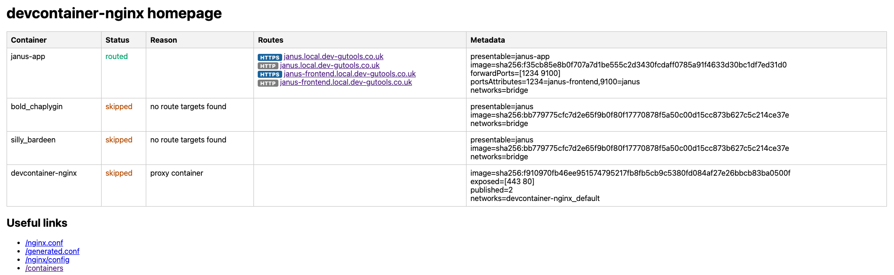

# devcontainer-nginx

A Docker-based reverse proxy for local development. It inspects running Docker containers and Dev Containers, discovers their exposed or forwarded ports, and automatically generates HTTPS routes like `https://myapp.local.dev-gutools.co.uk`.



## TL;DR

```bash
docker build -t devcontainer-nginx:local .
docker compose up -d --build
```

For development, consider:
```
docker compose up -d --build --force-recreate devcontainer-nginx
```
which can be run repeatedly to rebuild the proxy container and reload its configuration in one step.

Then start any app container, for example:

```bash
docker run -d --name myapp -p 3000:3000 your-app:latest
```

Open:

```text
https://myapp.local.dev-gutools.co.uk
```

The proxy also hosts a diagnostics homepage at:

```text
https://devcontainer-nginx.local.dev-gutools.co.uk/
```

See the [Quick Start Guide](./docs/QUICK-START.md) for the full setup flow.

## What this project does

`devcontainer-nginx` runs as a single container with:

- an Nginx TLS terminator and reverse proxy
- a Go discovery controller that watches Docker state
- automatic route generation for discovered containers and Dev Containers
- a homepage showing active routes and config details
- optional tunnel management for AWS ALB / SSM-style host tunnels

It is designed to work with the default Docker and Dev Container metadata already present on the machine. In most cases, no app-level labels or per-project configuration are required.

When a devcontainer needs to reach services on the host machine, Docker Desktop/Linux containers often need explicit host aliases such as:

```json
"runArgs": [
  "--add-host=host.docker.internal:host-gateway",
  "--add-host=janus.local.dev-gutools.co.uk:host-gateway"
]
```

This is especially important when the devcontainer runs multiple services that need to talk to each other through full HTTPS endpoints on the host machine, rather than only through loopback or local container networking. In those cases, the services inside the devcontainer may need to resolve the host machine by name (for example `janus.local.dev-gutools.co.uk`) or by the standard Docker host alias (`host.docker.internal`) while preserving TLS hostname validation and local-domain routing. The `host-gateway` mapping gives the container a stable route back to the machine running Docker while preserving the local domain used by this proxy.

## Main features

- Zero-config discovery of Docker and Dev Container apps
- Automatic hostname generation from container names or labels
- HTTPS by default for generated app routes
- Smart port detection for exposed and forwarded ports
- Safe config generation with `nginx -t` validation before reload
- Homepage and debug endpoints for route inspection
- Optional tunnel UI for creating ALB-backed local tunnels
- HTTPS upstream verification toggle for background fetches

## Documentation

- [Quick Start Guide](./docs/QUICK-START.md) — install, run, and access apps
- [Configuration Reference](./docs/CONFIGURATION.md) — environment variables and runtime settings
- [Architecture](./docs/ARCHITECTURE.md) — component and request flow details
- [Building](./docs/BUILDING.md) — local and Docker builds
- [Security](./docs/SECURITY.md) — TLS, Docker socket, and operational guidance
- [Requirements](./docs/REQUIREMENTS.md) — design constraints and goals

## Example workflow

1. Start the container with Docker Compose.
2. Run a local app container or open a Dev Container.
3. Let the proxy discover the app and generate a hostname.
4. Visit the generated host or the homepage to inspect routes.
5. Optionally use the built-in tunnel UI for ALB-backed tunnel setup.

## Homepage and admin endpoints

The proxy exposes a diagnostics homepage and a few useful endpoints:

- `https://devcontainer-nginx.<base-domain>/`
- `https://devcontainer-nginx.<base-domain>/nginx.conf`
- `https://devcontainer-nginx.<base-domain>/generated.conf`
- `https://devcontainer-nginx.<base-domain>/containers`
- `https://devcontainer-nginx.<base-domain>/tunnels`

The `/tunnels` page is used to create and manage host tunnel entries when a backend ALB or internal target is required.

## License

MIT
